# DeckForever

A small app that sets up **Battle.net** on a Steam Deck so you can install and play
**World of Warcraft: Forever**, adds it to the Steam library, and can repair, back up,
restore or uninstall the whole thing.

Blizzard does not support SteamOS. This app automates the community-proven route:
Battle.net running under GE-Proton as a non-Steam game. Nothing from Blizzard is
redistributed; the Battle.net installer is downloaded from Blizzard when you press Install.

**Its companion, the [DeckForever addon](https://github.com/eliog/DeckForeverAddon)**, does the
in-game half: one-press graphics presets measured on a Steam Deck (Battery, Balanced, Max FPS,
Max Quality), a picture of the Deck's Quick Access settings to match, and controller navigation.
The two are designed to be used together; see [In game: the DeckForever addon](#in-game-the-deckforever-addon).
Addon management is handled by CurseForge, which this app installs and configures.

DeckForever is a community project. It is not affiliated with or endorsed by Blizzard
Entertainment, Valve or CurseForge/Overwolf. World of Warcraft and Battle.net are trademarks of
Blizzard Entertainment; Steam and Steam Deck are trademarks of Valve Corporation.

## Step by step, with screenshots

<table>
<tr><td width="50%">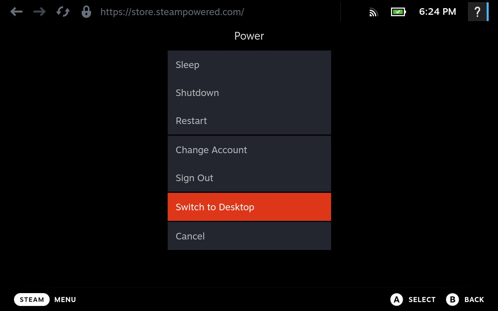</td>
<td><b>1. Switch to Desktop Mode.</b> Hold the power button, choose <i>Switch to Desktop</i>.<br><br>
In Desktop Mode: right trackpad moves the pointer, <b>R2</b> is left click, <b>L2</b> is right click.</td></tr>
<tr><td>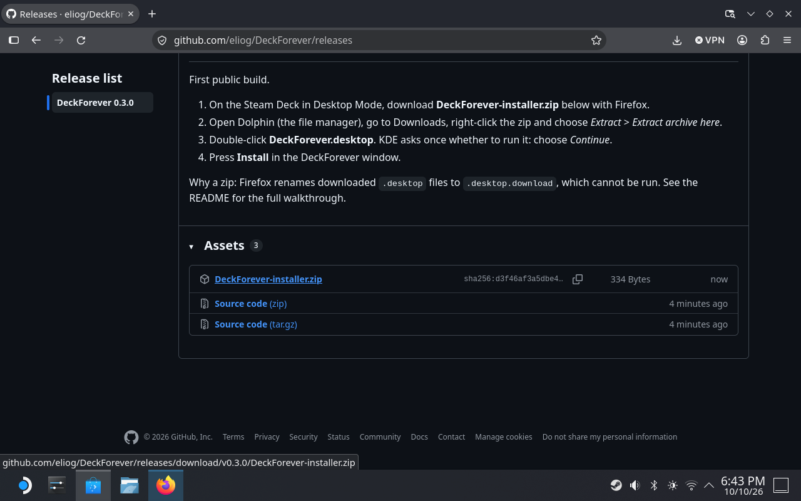</td>
<td><b>2. Download the installer.</b> In Firefox open
<a href="https://github.com/eliog/DeckForever/releases">github.com/eliog/DeckForever/releases</a>
and tap <code>DeckForever-installer.zip</code>.</td></tr>
<tr><td>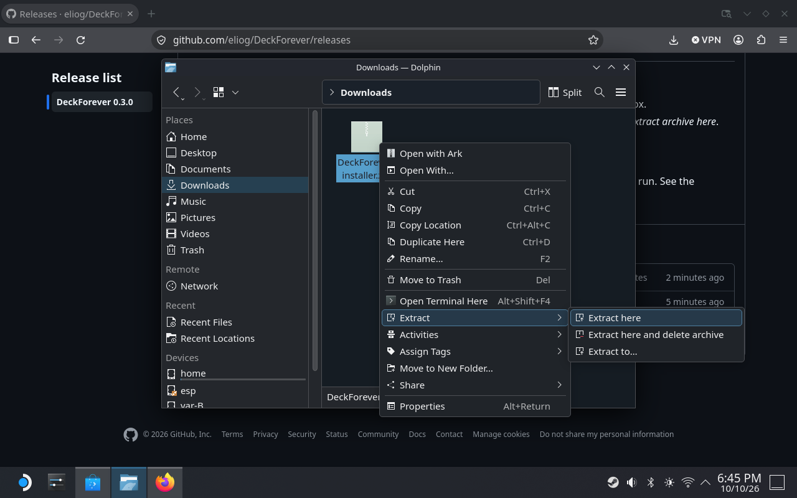</td>
<td><b>3. Extract it.</b> Open Dolphin (the folder icon in the taskbar), go to Downloads, right-click the zip (L2) and choose <i>Extract</i> &gt; <i>Extract here</i>.</td></tr>
<tr><td>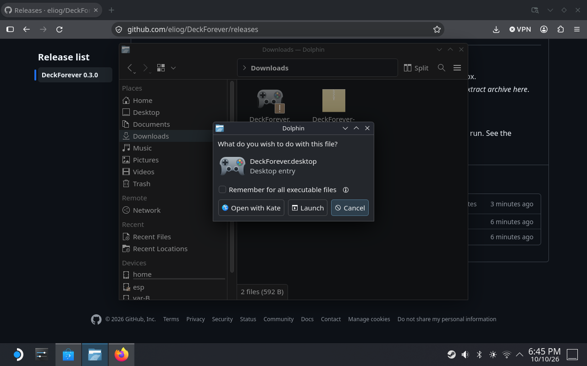</td>
<td><b>4. Run it.</b> Double-click <code>DeckForever.desktop</code>, choose <b>Launch</b>, then <b>Continue</b> on the warning that follows. Both prompts appear only the first time.</td></tr>
<tr><td>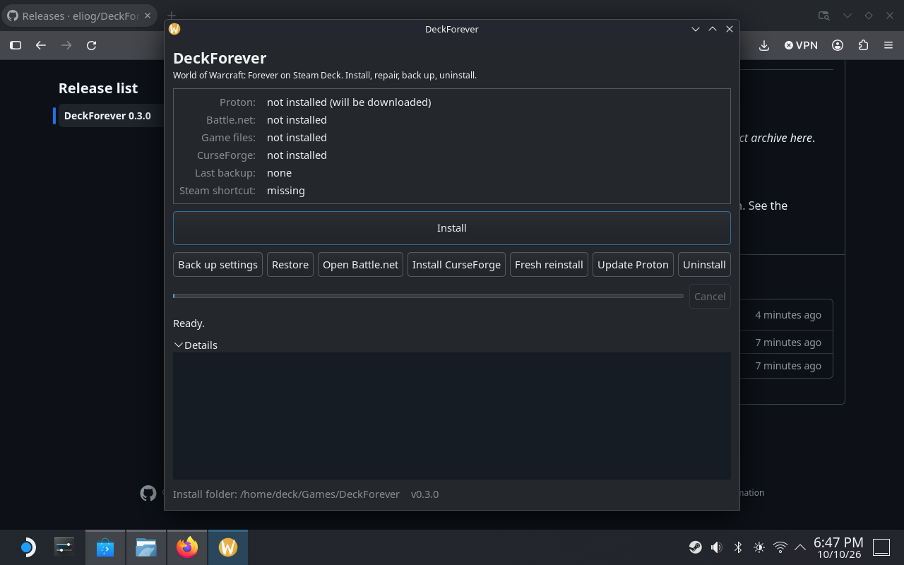</td>
<td><b>5. Press Install.</b> The app downloads GE-Proton, asks Steam to fetch its runtime (click Install in Steam's window the first time), builds the Wine prefix and installs Battle.net. A Blizzard window appears on its own; do not log in there.</td></tr>
<tr><td>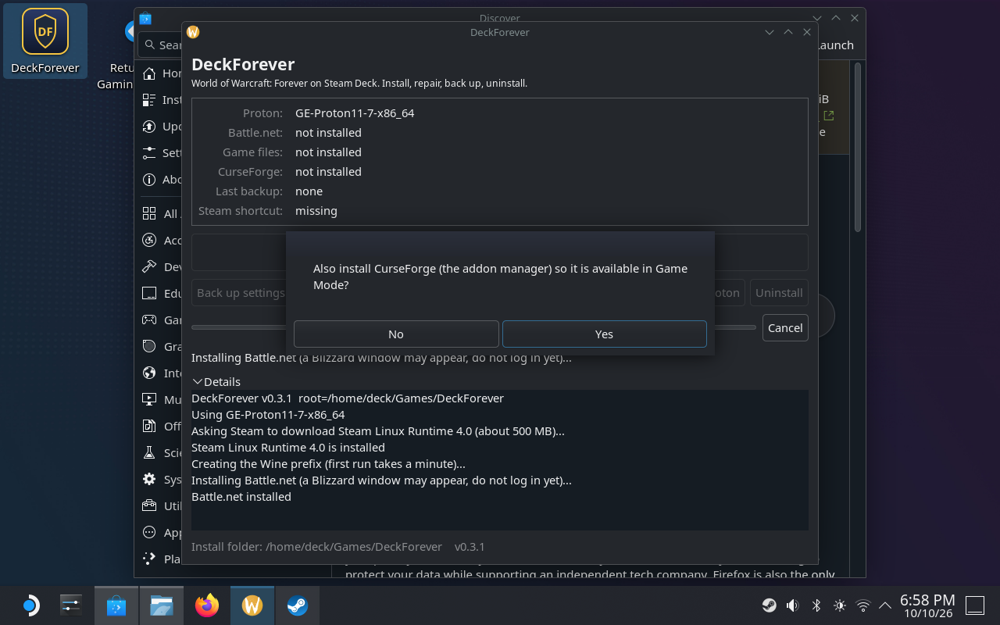</td>
<td><b>6. Say yes to CurseForge</b> (the addon manager) and yes to closing Steam for a moment so the shortcuts can be written.</td></tr>
<tr><td>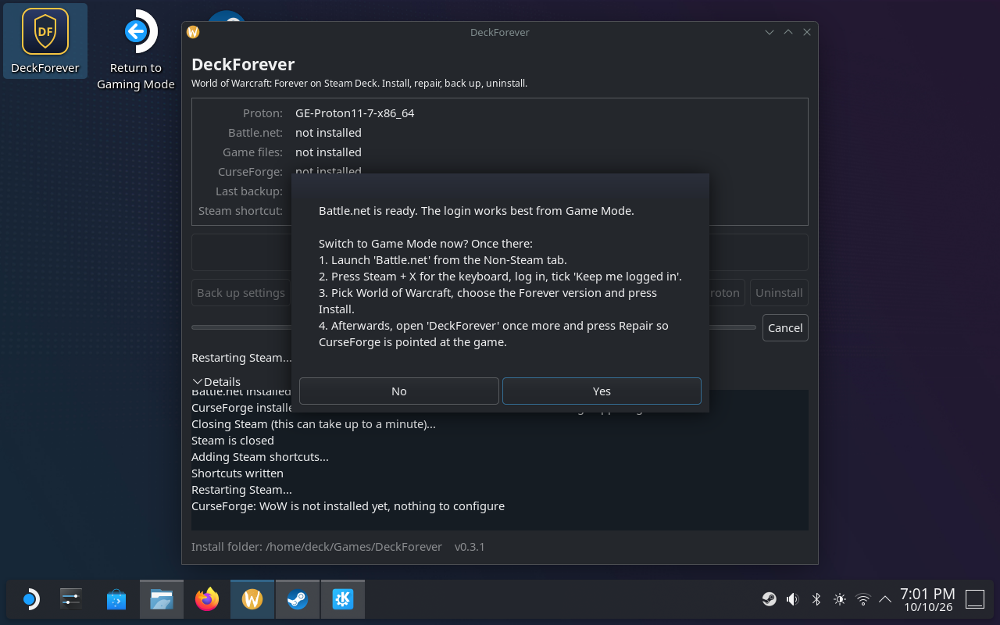</td>
<td><b>7. Switch to Game Mode</b> when the app offers it. The Battle.net login is far easier there.</td></tr>
<tr><td>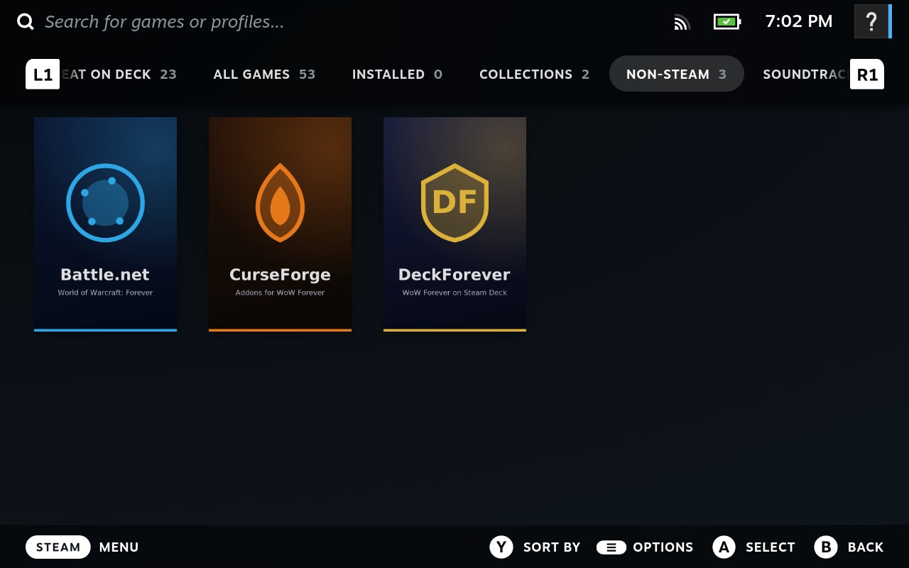</td>
<td><b>8. Open Battle.net</b> from the Non-Steam tab of the library. CurseForge and DeckForever are there too.</td></tr>
<tr><td>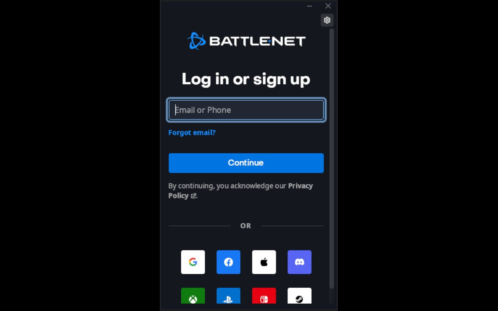</td>
<td><b>9. Log in.</b> Press <b>Steam + X</b> for the keyboard. On the e-mail code page just type the digits. Tick <i>Keep me logged in</i>.</td></tr>
<tr><td>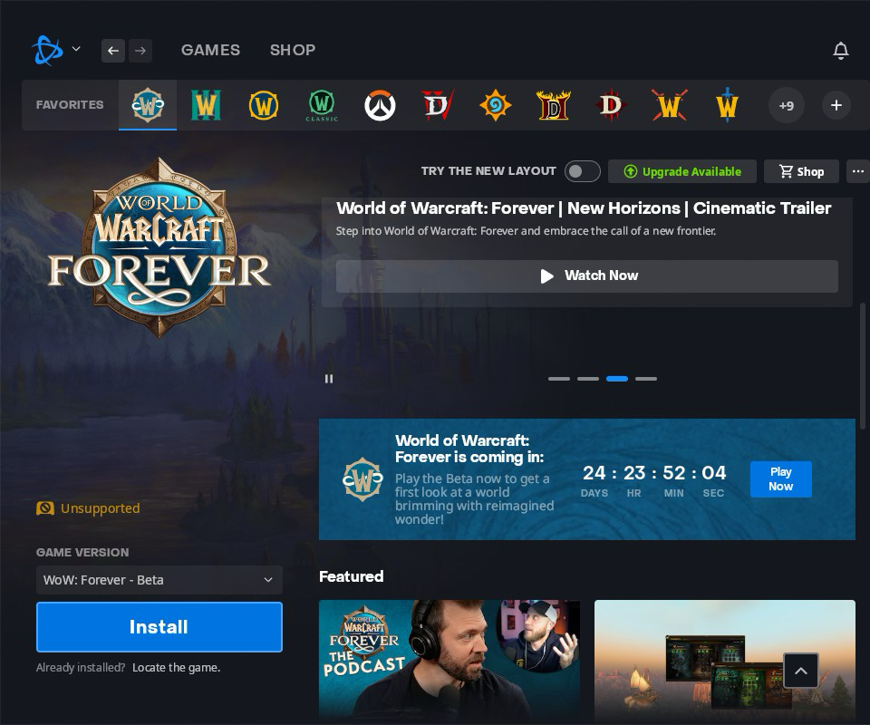</td>
<td><b>10. Install the game.</b> Select World of Warcraft, make sure Game Version says <i>WoW: Forever</i>, press <b>Install</b>, accept Blizzard's "Unsupported" handheld notice and the default folder.</td></tr>
<tr><td>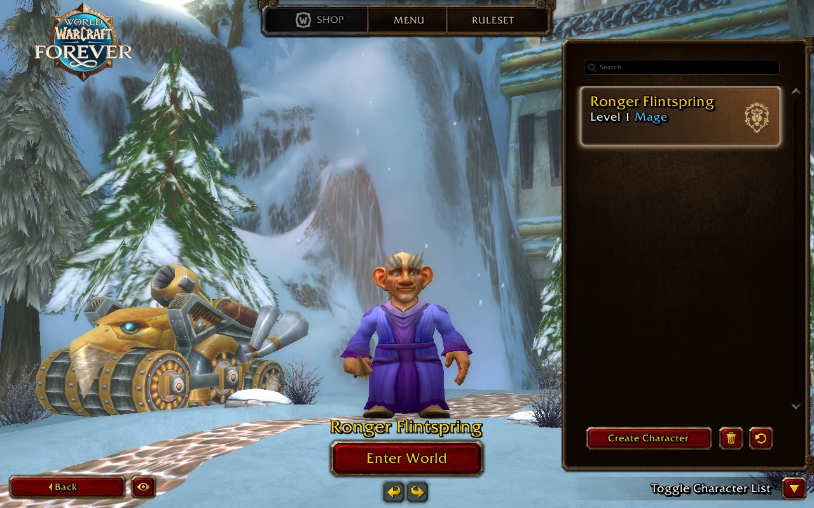</td>
<td><b>11. Play.</b> The game is playable before the download finishes. Next time: Steam, Battle.net, Play. Enable the controller UI in the game's Settings &gt; Gamepad.</td></tr>
</table>

## In game: the DeckForever addon

Once WoW runs, add the [DeckForever addon](https://github.com/eliog/DeckForeverAddon): search for
*DeckForever* in CurseForge (installed by this app; [project page](https://www.curseforge.com/wow/addons/deckforever)),
or download the zip from its [releases](https://github.com/eliog/DeckForeverAddon/releases) and extract it into
`World of Warcraft/_classic_beta_/Interface/AddOns/`. On first login it offers a preset; its
Steam Deck tab then shows how to set the Deck's Quick Access > Performance menu to match.

| Preset | Frame rate | Battery life (Deck OLED, questing) |
|---|---|---|
| Battery | 30 fps | ~4.3 h |
| Balanced | 45 fps, with shadows | ~3.7 h |
| Max FPS | 60 fps | ~2.8 h |
| Max Quality | 30 fps, everything high (plugged in) | ~2.5 h |

## For players

1. Switch to **Desktop Mode** (Steam button > Power > Switch to Desktop).
2. Open Firefox and download **DeckForever-installer.zip** from
   https://github.com/eliog/DeckForever/releases. Open Dolphin (the file manager in the
   taskbar), go to Downloads, right-click the zip, choose *Extract* > *Extract here*,
   then double-click **DeckForever.desktop**. Dolphin asks what to do with the file: choose **Launch**,
   and on the warning that follows ("This will start the program: DeckForever") choose **Continue**.
   (It is a zip because Firefox renames downloaded `.desktop` files to `.desktop.download`,
   which cannot be run. Alternative, in Konsole:
   `curl -fsSL https://raw.githubusercontent.com/eliog/DeckForever/main/bootstrap.sh | bash`)
3. The DeckForever window opens. Press **Install**. It also offers to install
   **CurseForge**, the addon manager, so you can manage addons from Game Mode.
   - If you already have WoW installed through NonSteamLaunchers, Lutris, Bottles or Heroic,
     the app finds it and offers to adopt it, so nothing is downloaded twice.
   - Steam closes and reopens once so the shortcut can be written.
4. The app offers to switch to **Game Mode**. Accept, then launch **Battle.net** from the
   Non-Steam tab. Log in with Steam + X for the keyboard (tick *Keep me logged in*; on the
   e-mail code page just type the digits), select World of Warcraft, pick the Forever version
   and press Install.
   (Why Game Mode: in Desktop Mode the Steam keyboard's taps also land in the Battle.net
   window and steal focus. The Plasma keyboard or a USB keyboard work there too.)
5. From now on: **Battle.net** in your Steam library, then Play.
6. Controller: use the game's built-in **Gamepad UI (Alpha)**, enabled with a checkbox under
   Options > Gamepad (Alpha). It is what Deck players recommend; ConsolePort and "Easy
   Controller - Forever" are optional add-ons. Steam Input: the default gamepad template,
   right trackpad as mouse for Battle.net and mouse-only dialogs, back grips mapped to F13-F16
   if you want extra buttons.

A **DeckForever** icon is added to the application menu and the desktop, and a
**DeckForever** entry to the Steam library, so you can come back for repairs,
backups or a fresh reinstall. In Game Mode the entry offers backups, restores and Open
Battle.net; install, repair, Proton updates and uninstall need Desktop Mode because they
restart Steam.

### The window

| Button | What it does |
|---|---|
| Install / Repair | Everything above. Safe to press again at any time; it only redoes what is missing. Once WoW is installed, Repair also points CurseForge at it. |
| Install CurseForge | Downloads the official CurseForge Linux app, adds a `CurseForge` entry to Steam (native, works in Game Mode with the trackpad and Steam + X) and registers your Forever client in it so no browsing for folders is needed. |
| Back up settings | Saves WTF (settings, keybinds, macros, addon data), Interface, Fonts and the Battle.net config to `backups/`. |
| Restore | Puts a backup back. |
| Open Battle.net | Opens the launcher outside Steam (for example to log in during setup). |
| Fresh reinstall | Backup, wipe the Wine prefix (game files are kept unless you say otherwise), reinstall, restore. |
| Update Proton | Fetches the newest GE-Proton and points the shortcut at it. |
| Uninstall | Removes the shortcut and, if you confirm, the whole folder (offers a final backup). |

The Steam shortcut is called **Battle.net**, or **Battle.net (WoW Forever)** if another
launcher already owns a "Battle.net" entry. All entries the app creates get library artwork
(portrait, wide, hero, logo and icon), drawn on the Deck with cairo in a matching style; no
third-party logos are shipped.

### Troubleshooting

- **White or blank Battle.net login window**: open
  `~/Games/DeckForever/prefix/pfx/drive_c/users/steamuser/AppData/Roaming/Battle.net/Battle.net.config`
  and flip `HardwareAcceleration` (the app sets it to `true`, which works on the Deck with
  GE-Proton 10/11; older guides say `false`). Then delete the `BrowserCaches` folder under
  `.../AppData/Local/Battle.net/` and start the launcher again.
- **On-screen keyboard taps un-focus the login field (Desktop Mode)**: the Steam keyboard
  clicks through to the Battle.net window there. Log in from Game Mode instead, or drag the
  window to the top of the screen, or enable the Plasma keyboard (System Settings > Keyboard
  > Virtual Keyboard > Maliit).
- **Battle.net installer says it cannot connect to the patch service (BLZBNTBTS00000028)**: Proton
  ran without its Steam Linux Runtime, which breaks HTTPS inside Wine. The app now asks Steam to
  download the runtime first (one click in Steam's window); if that was skipped, open Steam,
  let the "Steam Linux Runtime" download finish (Library > Tools), then press Install again.
- **Battle.net broke after a Blizzard update**: Update Proton, then Fresh reinstall if needed.
- **Game shows as not installed after adopting or reinstalling**: in Battle.net just press
  **Install** and accept the default folder (`C:\Program Files (x86)\World of Warcraft`). It
  finds the existing files, finishes in seconds and then verifies them ("reclaiming space").
  "Scan for games" may not find it; Install does.
- **Battle.net cannot update itself after a Blizzard launcher update**: add
  `WINE_SIMULATE_WRITECOPY=1` in front of `%command%` in the shortcut's Launch Options (the
  2023 workaround; current Wine no longer needs it by default).
- **Game freezes at 100% on the loading screen, or FPS is poor**: in the game's graphics
  options set *Secondary Lighting* to Fair (engine CVars `giQuality` and `RAIDgiQuality`).
  It is the single biggest FPS and stability lever in the Forever client. Shadows on Low
  cost nothing visually in this build. DX12 is the default; DX11 is the fallback.
- **Never set** `PROTON_LOG=1` (Forever drops to single-digit FPS), `PROTON_ENABLE_WAYLAND`
  or HDR variables (the Wayland path is where the GE-Proton 11 regressions live).
- **"Blizzard Agent went to sleep"**: quit Battle.net, delete
  `~/Games/DeckForever/prefix/pfx/drive_c/ProgramData/Battle.net`, open Battle.net, Scan for games.
- **Shortcut vanishes from Steam** and you also use NonSteamLaunchers: its background scanner
  (`NSLGameScanner.service`) empties `shortcuts.vdf` when the file is not executable. The app
  writes the file executable to avoid this; if it still happens, press Repair again.
- **Logs**: `~/Games/DeckForever/logs/`. The Details pane in the window shows the same.

## Updates

The app checks GitHub's latest release once in a while (at most every 6 hours) and, when a newer
version exists, shows an **Update to vX.Y.Z** button in its footer. Pressing it downloads that
release, replaces the app copy in `~/Games/DeckForever/app` (your settings and files are kept)
and restarts the app. The one-file installer always fetches the latest release as well. From the
command line: `./run.sh check-update` and `./run.sh update`.

## Folder layout

```
~/Games/DeckForever/
  app/                        the app itself (python package + run.sh)
  tools/CurseForge.AppImage   the CurseForge app (its own settings stay in ~/.config/CurseForge)
  prefix/                     Wine prefix; Battle.net lives here
  games/World of Warcraft/    game files, symlinked into the prefix
  backups/  downloads/  logs/
  state.json
```

## Command line

The same engine runs without a window, which is handy over SSH:

```
./run.sh status | install | adopt [dir] | curseforge [--update] | backup | restore [file] | reinstall | update-proton | uninstall
```

Environment: `DECKFOREVER_ROOT` (install folder, ext4 SD card is fine), `DECKFOREVER_PROTON`
(pin a GE-Proton folder name), `DECKFOREVER_FLAVOR_DIR` (e.g. `_classic_beta_`), `DECKFOREVER_ADOPT_FROM`,
`DECKFOREVER_ASSUME_YES=1` (non-interactive), `DECKFOREVER_NO_GUI=1`, `DECKFOREVER_NO_CURSEFORGE=1`, `GITHUB_TOKEN`.

## Development

```
deckforever/engine.py           all install logic, UI-agnostic (BaseUI callbacks)
deckforever/gui.py              GTK 3 window (PyGObject ships with SteamOS)
deckforever/cli.py              text front end
deckforever/steam_shortcuts.py  binary shortcuts.vdf + config.vdf CompatToolMapping writer,
                               with dedupe and prune of dead non-Steam leftovers
deckforever/art.py              cairo-drawn Steam library artwork for the app's entries
tests/run_tests.sh             test suite (macOS or Linux), nothing touches a real Steam install
RESEARCH.md                    how WoW runs on the Deck, sources
ADDON.md                       spec for the companion in-game addon (separate repo DeckForeverAddon)
```

Requires only what SteamOS already has: Python 3, GTK 3 bindings, curl, tar.

## Credits

Built by eliog with Claude (Anthropic) as a pair-programming assistant. Thanks to the
NonSteamLaunchers, Lutris and GE-Proton projects, whose work on Battle.net under Proton this
builds on.

## Roadmap / notes

- **DeckForever addon**: released as [DeckForeverAddon](https://github.com/eliog/DeckForeverAddon)
  and on [CurseForge](https://www.curseforge.com/wow/addons/deckforever) as *DeckForever*.
- **Proton version policy.** A fresh install downloads the newest GE-Proton (11-7 as of
  October 2026, verified with WoW Forever). After that the app keeps using the build the
  shortcut was written with; only *Update Proton* moves to a newer one, so a surprise GE
  release never changes a working setup. Builds older than GE-Proton 10-21 (the Battle.net
  launcher fixes) are not used. `DECKFOREVER_PROTON=GE-ProtonX-Y-x86_64` pins one by hand. Proton
  Experimental is a known-working fallback if a GE build misbehaves.
- Decky Loader plugin for a Game Mode install flow.
